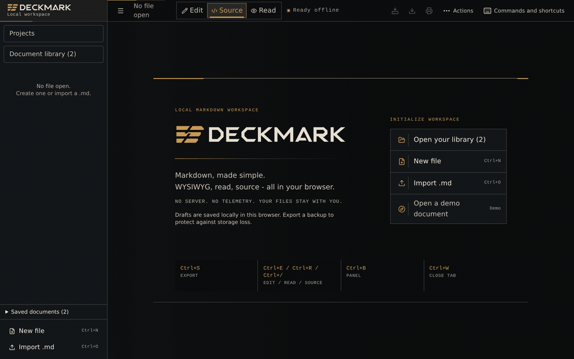
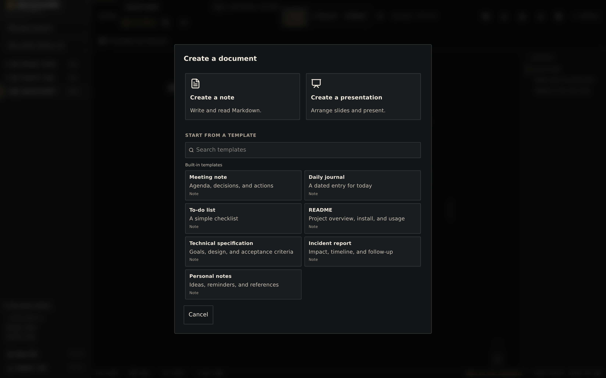
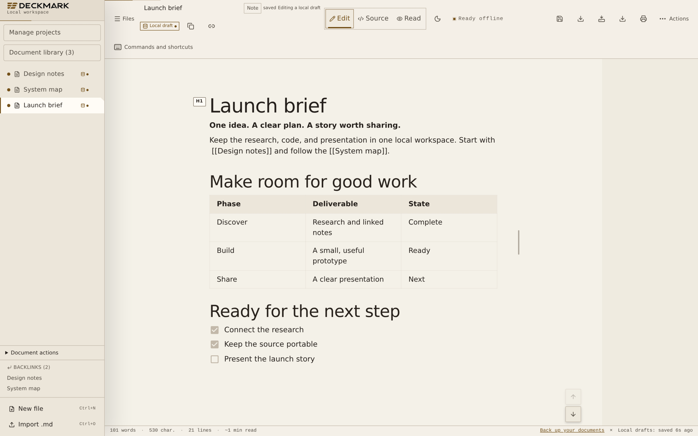
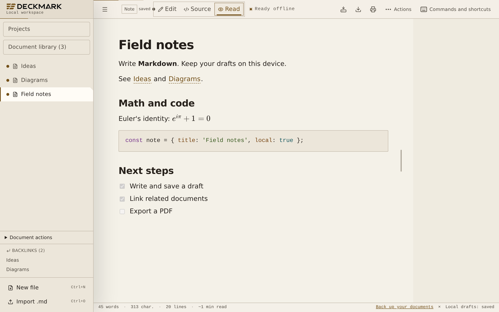
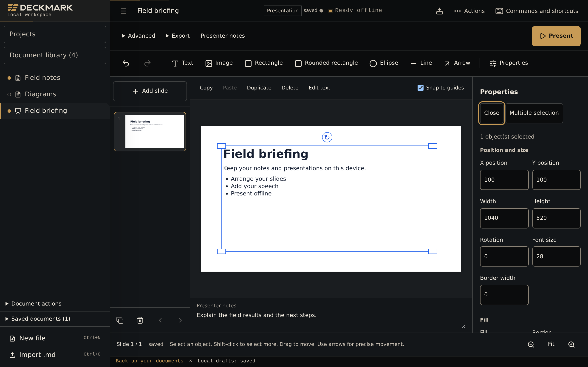

<p align="center">
  <picture>
    <source media="(prefers-color-scheme: dark)" srcset="static/brand/logo-dark.svg">
    
  </picture>
</p>

<h1 align="center">DeckMark</h1>

<p align="center"><strong>Your Markdown. On your device.</strong></p>

<p align="center">
  <a href="https://www.deckmark.dev/"><strong>Open the web app</strong></a> ·
  <a href="#get-started">Get started</a> ·
  <a href="#browser-and-desktop-support">Desktop and browsers</a> ·
  <a href="docs/EDITIONS.md">Editions</a> ·
  <a href="#documentation">Docs</a> ·
  <a href="#status">Status</a>
</p>

<!-- readme:section positioning -->
## Why DeckMark?

DeckMark is a Markdown workspace with two editions: **Web Light** and
**Desktop Complete (Beta)**. Both editions support notes, presentations, code,
images, and imported PDFs. Write and link notes, or arrange presentation slides.
The web app stores drafts on your device and works offline after its
offline resources are ready. Desktop Complete adds native file access and
native operating-system integration.

Web Light is a complete browser product. It is free and it is not a trial.
Use it for a personal document library that you can export as plain files.
AI is optional and disabled by default. Cloud sync, shared editing, accounts,
and plugins are outside the current product.
See the [edition matrix](docs/EDITIONS.md) for the complete comparison.

<a id="privacy-and-limits"></a>
<!-- readme:section privacy -->
## Privacy and local storage

**Accounts:** No product account, external-service account, or API key is required.

**Telemetry:** The app sends no telemetry or crash reports. Errors go to the local console and in-app notifications.

**AI:** An optional OpenAI-compatible connection sends your prompt and selected context to the provider that you configure. Review the context before you send it. Web Light requires browser-key consent and keeps the key in tab session storage, not a secure vault. Desktop stores the key in the operating-system credential store and sends requests through Rust. See [AI and network access](docs/USER_GUIDE.md#ai-and-network-access).

**Data:** Drafts, projects, assets, history, workspaces, templates, snippets, comments, and the optional search index use IndexedDB on your device. Preferences use localStorage. The web app contacts its host to load and update app files. Documents stay local unless you send selected context to an AI provider. Remote images are blocked until you choose to load them. That action contacts the image host and reveals your IP address, without cookies or a referrer.

**Files:** A browser disk link uses the browser file API and an explicit action. Desktop accepts only paths that you select. Neither edition gives the application unrestricted filesystem access.

There is no required backend, cloud storage, or runtime CDN. Rendering sanitizes
document HTML. See the [security policy](SECURITY.md) for data flows and controls.

**Browser storage is not a backup.** Export a copy before you clear browser data
or change profiles. Draft saves use a **400 ms** delay and report write failures.
If the status says **Not saved locally**, keep the editor open, free storage, and
select **Retry save**. A browser or system crash can lose text that has not reached
IndexedDB.

<!-- readme:section capabilities -->
<a id="notes-and-presentations"></a>

## Documents



Select **New file**, then choose **Note**, **Presentation**, **Code**, or **JSON**.
The Code choice selects a language and suggests a matching extension. Each file
keeps its own type. The app does not convert notes to presentations or append
`.md` to a code file.

| Document type | What you can do |
| --- | --- |
| **Note** | Use **Edit**, **Source**, and **Read**. Add tables, checklists, images, formulas, and diagrams. Use an outline, tags, and wiki links. |
| **Presentation** | Edit slides directly in the document area. Arrange text, images, shapes, and connectors. Add presenter notes and select **Present** for full screen. |
| **Code and JSON** | Create or import text and code files. Use syntax highlighting, search, indentation controls, and JSON checks, formatting, or minification. |
| **Image** | Import an image, draw annotations, and export a flattened PNG. Annotation strokes are temporary until exported. |
| **PDF** | Import and export PDF files. Viewing depends on the browser PDF viewer and security policy. Use **Open PDF** or download the file when inline viewing is blocked. |

The New dialog creates notes, presentations, code files, and JSON files. Import
image and PDF files. PDF support does not include text extraction, OCR, or PDF
editing. See [code, images, and PDFs](docs/USER_GUIDE.md#code-images-and-pdfs).

The toolbar adapts to the available document width. **Edit**, **Source**, and
**Read** keep their labels on small screens. Use **Actions** for file commands
that do not fit in the toolbar.

For notes, Source provides syntax highlighting, search, replacement, and
per-document undo. Its preview divider works with the pointer or arrow keys.
The app remembers its position and stacks the panes on narrow screens.
Empty paragraphs export as blank Markdown lines. Existing HTML and table cell
breaks stay in the exported file.

Presentations stay in one Markdown file. A terminal metadata block stores slide
layouts, and the body keeps text and images readable in other editors. Use
**Export** for Markdown, HTML, or PDF. HTML and PDF omit presenter notes; Markdown
keeps them in the file data. Use **Advanced > Markdown source** to edit a source
draft, then **Apply** or **Cancel**. See the
[presentation guide](docs/presentation-editor.md) and
[file format](docs/presentation-format.md).

DeckMark starts in dark mode with the Relay identity: graphite, warm text, and
amber accents. Choose **Light** for a warm paper canvas or **System** to follow
your device. Settings offers English and French. English is the default; the app
selects French when it detects a French browser language.

<details>
<summary><strong>See document creation, notes, and the slide editor</strong></summary>



<p align="center">
  <picture>
    <source media="(prefers-color-scheme: dark)" srcset="docs/screenshots/mode-wysiwyg.webp">
    
  </picture>
</p>

<p align="center">
  <picture>
    <source media="(prefers-color-scheme: dark)" srcset="docs/screenshots/mode-read.webp">
    
  </picture>
</p>



</details>

<!-- readme:section capabilities -->
## Keep your documents together

- **Write structured content:** use GFM tables, task lists, code blocks, KaTeX
  formulas, Mermaid diagrams, YAML front matter, and embedded images. Mermaid
  uses the Dagre layout online and offline; document layout overrides are ignored.
- **Find and connect notes:** use tags, document search, wiki links, backlinks,
  and the link graph. The optional [local search index](docs/USER_GUIDE.md#local-search-index)
  uses local text features without a provider request or model download.
- **Reuse content:** save code snippets with tags and placeholders. Linked content
  blocks keep a readable Markdown snapshot that you update explicitly. See
  [snippets and content blocks](docs/USER_GUIDE.md#snippets-and-content-blocks).
- **Review changes:** compare version history, disk conflicts, and cross-file
  replacements before you apply them.
- **Manage the library:** find open and closed documents, select several files,
  and restore deleted documents from trash. Closing a tab keeps its document in
  the library. Deleting a document moves it to trash for 30 days.
- **Keep portable projects:** import a folder or ZIP with document paths and
  local assets. Export the project with its resources and a link report.
- **Check documentation:** find missing links, invalid front matter, heading
  problems, and missing images offline. Export a static documentation site with
  local assets and optional search. See [documentation projects](docs/USER_GUIDE.md#check-and-export-documentation).
- **Save back to disk:** keep file links in supported browsers and Desktop.
  Revision checks detect external edits before an overwrite. Disk saves require
  an explicit action; a local draft save does not write to the linked file.

Desktop Complete also adds local Git status, diffs, staging, and commits for an
approved project folder. Its optional global quick capture saves notes and
snippets. Both features use explicit actions. See
[Desktop tools](docs/USER_GUIDE.md#desktop-tools).

<!-- readme:section capabilities -->
## Export and back up

Download Markdown, a library or project ZIP, or self-contained HTML for offline
reading. PDF export opens the browser or system print dialog after it prepares
the document content. Select a PDF printer there. The **PDF (A4)** editor width
guides you to a 178 mm text area; the print dialog controls final page settings.

Use **Settings > Export a backup** to keep a JSON copy outside browser storage.
Settings can also check a backup before restore. Backups include open and closed
documents, projects, assets, workspaces, custom templates, snippets, and comments.
They exclude trash, version history, the search index, API keys, and disk permissions.

Optional backup encryption uses AES-GCM and PBKDF2 through WebCrypto. Keep the
passphrase: an encrypted backup cannot be recovered without it. See
[backups and storage health](docs/USER_GUIDE.md#backups-and-storage-health).

Desktop can schedule unencrypted JSON snapshots in a selected folder while the
app runs. Settings provides a retention count, manual backup, and restore preview.

Scripts and CI pipelines can use the local Node CLI without the GUI:

```sh
npm run cli -- check docs --json
npm run cli -- export . --format zip --out project.zip
```

The CLI reuses the documentation checker, project archive, search matcher, and
link rules. It does not start a server or a GUI. Commands, exit codes, JSON
schemas, and the known renderer differences are in [docs/CLI.md](docs/CLI.md).
The separate [local MCP server](docs/MCP.md) exposes read, search, check, and
patch-proposal tools to a client over standard input and output. It needs an
explicit root and does not write files. Both tools run from a source checkout.

<!-- readme:section compatibility -->
## Browser and Desktop support

Web Light needs no installation. Disk access depends on the browser:

| Edition | Platform | Test scope | Save back to a disk file |
| --- | --- | --- | --- |
| Web Light | Chromium | Full desktop suite and mobile workflows | File System Access API where available |
| Web Light | Firefox | Selected core workflows | Download fallback |
| Web Light | Safari / WebKit | Selected desktop and mobile workflows | Download fallback |
| Desktop Complete (Beta) | macOS, Windows, and Linux | Tauri app with native WebView tests | Native in-place editing on selected paths |

[Desktop Complete downloads](https://github.com/ThomasCrouzet/deckmark/releases)
are separate `desktop-v<version>` prereleases. Installers are unsigned and can
trigger an operating-system warning. Older releases can use the previous mdsh
name. The Desktop release workflow includes checksums and build provenance.
Desktop update delivery is on standby. The app does not check for or install
updates. Download and install each new release manually.
See the [Desktop guide](docs/USER_GUIDE.md#desktop-complete-app) for
requirements and supported architectures.

The Beta channel publishes four installers:

| Platform | Installer |
| --- | --- |
| macOS Apple Silicon | `deckmark_<version>_macOS_Apple-Silicon.dmg` |
| Windows x64 | `deckmark_<version>_x64-setup.exe` (NSIS) |
| Linux x64 | `deckmark_<version>_amd64.deb` |
| Linux x64 | `deckmark_<version>_amd64.AppImage` |

Compare every file with `SHA256SUMS` in the same release.

Desktop Complete does not provide unrestricted filesystem access. A native
picker approves each path, and a session capability limits later operations to
that path. Web Light uses the browser sandbox and any file link that the browser
supports.

The interface supports keyboard navigation and reduced motion. Browser tests
check focus behavior and accessibility rules. These checks do not replace a human
accessibility audit. The test scope above describes the configured suites, not a
claim that every test passes on every device. The
[edition matrix](docs/EDITIONS.md) lists the shared capabilities and the
Desktop-only capabilities.

<a id="start-writing"></a>
<!-- readme:section get-started -->
## Get started

### Write and export your first note

**Requirements:** Web Light needs a browser with JavaScript and IndexedDB, and a
connection for the first load. No credentials or configuration are required.

1. Open the [web app](https://www.deckmark.dev/), then select
   **New file**, then **Note**. You can also import Markdown or open the built-in demo.
   If the custom domain is not available, open the
   [GitHub Pages fallback](https://thomascrouzet.github.io/deckmark/).
2. Select **Source** and enter this Markdown:

   ```markdown
   # Field notes

   - [x] Write a local note
   - [ ] Export a copy
   ```

3. Select **Read**. The document shows the **Field notes** heading and two task
   items, with the first item checked.
4. Wait for **Local drafts: saved** in the status bar. Reload the page to open
   the saved document again.
5. Use **Actions > Export as markdown** to download the source. Use
   **Settings > Export a backup** to keep a copy of the full library.

### Create your first presentation

1. Select **New file**, then **Presentation**. The slide editor opens in the
   document area with one empty slide.
2. Select **Text** to add content. Double-click the object to edit it, then select
   **Done**.
3. Enter your speech in **Presenter notes** below the slide. The header control
   hides or shows this panel.
4. Select **Present**. Press Escape to return to editing.
5. Select **Export > HTML** for an offline slide show, or **Export > PDF / Print**
   for one slide per page.

### Work offline

Use the browser install action to add the PWA. Wait until **Ready offline**
appears before you disconnect. Editing, rendering, search, and export then work
without a connection. The service worker caches the application for the current
address and base path. Remote images must first be embedded or imported to remain
available offline. See [PWA installation](docs/USER_GUIDE.md#install-the-pwa).

### Useful shortcuts

Use **Control** instead of **Command** on Windows and Linux. **Commands** lists
all shortcuts, and Settings lets you change application shortcuts.

| Default shortcut | Action |
| --- | --- |
| `Cmd+N` / `Cmd+O` | New document / import Markdown |
| `Cmd+E` / `Cmd+/` / `Cmd+R` | Note: Edit / Source / Read |
| `Cmd+Shift+P` | Command palette |
| `Cmd+F` / `Cmd+Shift+F` | Find in document / search across documents |
| `Cmd+S` / `Cmd+Shift+S` | Export Markdown / save to disk |
| `Cmd+P` / `Cmd+,` | Export PDF / Settings |
| `Cmd+Shift+L` | Present active presentation |
| `Ctrl+Tab` / `Ctrl+Shift+Tab` | Next / previous open document |

Some browsers reserve these keys. Use **Commands** when a shortcut is unavailable.

### Build and contribute

Use **Node 22 or later** and npm. The package declares npm 10.9.8. Run these
commands for a new checkout; the committed lockfile fixes dependency versions:

```sh
git clone https://github.com/ThomasCrouzet/deckmark.git
cd deckmark
npm ci --legacy-peer-deps
npm run dev
```

Open the local URL that Vite prints, then follow the first-note steps above.
The development server is for local work. Use a production build to check PWA
installation and offline behavior.

Before a pull request:

```sh
npm run check
npm run lint
npm test
npm run build
npm run size
npx playwright install --with-deps chromium firefox webkit
npx playwright test --ignore-snapshots --grep-invert "Snapshots visuels"
```

On Linux without a display, prefix the final command with `xvfb-run -a`.
Browser tests produce HTML and JSON reports. E2E tests are the preferred method;
isolated tests cover documented failure risks that browser workflows miss.
See the [test policy and artifacts](docs/TESTING.md).

The stack uses **Svelte 5**, **SvelteKit**, **TypeScript**, **Milkdown**,
**CodeMirror**, **Dexie**, and **Tauri 2**. Desktop builds also need the Rust version
and native libraries specified in [CONTRIBUTING.md](CONTRIBUTING.md).

<!-- readme:section documentation -->
## Documentation

| Guide | Contents |
| --- | --- |
| [Editions and support](docs/EDITIONS.md) | Web Light and Desktop Complete matrix, requirements, storage, hosting, and support limits. |
| [User guide](docs/USER_GUIDE.md) | Editing, imports, images, disk links, backups, and shortcuts. |
| [Presentation editor](docs/presentation-editor.md) · [File format](docs/presentation-format.md) | Create, present, and export Markdown slide decks. |
| [Command-line interface](docs/CLI.md) | Local commands, exit codes, JSON output, and renderer differences. |
| [Local MCP server](docs/MCP.md) | Client setup, approved roots, read-only tools, and patch proposals. |
| [Contributing](CONTRIBUTING.md) · [Development](docs/DEVELOPMENT.md) | Setup, code rules, and module reference. |
| [Architecture](ARCHITECTURE.md) | Storage, offline resources, rendering, and native file access. |
| [Testing](docs/TESTING.md) | Failure risks, browser commands, and repeatable report artifacts. |
| [Security policy](SECURITY.md) | Privacy boundaries and private vulnerability reports. |
| [Releases](https://github.com/ThomasCrouzet/deckmark/releases) · [Changelog](CHANGELOG.md) | Published versions and changes. |
| [Brand assets and demo capture](docs/BRANDING.md) | Logos, screenshots, and capture commands. |
| [Support](SUPPORT.md) · [Documentation index](docs/README.md) | Help, reporting rules, and the complete guide list. |

<!-- readme:section status -->
## Status

DeckMark provides **Web Light** and **Desktop Complete (Beta)**. Web Light is
the primary free edition and it is not a trial. Editing, linked documents,
portable projects, backups, and Markdown presentations are implemented in both
editions. See the [edition matrix](docs/EDITIONS.md) for the exact differences.

Current limits:

- **Unavailable capabilities:** no cloud sync, shared editing,
  account, plugin system, secure browser API key vault, or unrestricted filesystem
  access.
- **Portability:** both editions use the same document, project ZIP, and backup
  formats. New metadata can require a newer release. See [format and test limits](docs/EDITIONS.md#support-boundaries).
- **AI:** requires provider configuration and explicit actions. Browser requests
  depend on the provider's CORS policy and the app's connection policy. No local
  inference engine is bundled.
- **Library size:** the working target is about **200 to 300 documents**.
- **Imports:** a file selection accepts up to 300 files and 64 MiB in total,
  with a 16 MiB limit per document. Projects have additional asset and archive
  limits. See [import limits](docs/USER_GUIDE.md#import-documents) and
  [portable projects](docs/USER_GUIDE.md#portable-projects).
- **Source formatting:** sentence edits in the visual editor retain formatting
  outside the changed content. Structural edits can require new Markdown syntax.
  Use Source for syntax that the visual editor cannot represent. The
  [source fidelity harness](docs/testing/source-fidelity.md) checks exported
  source and records changes outside the expected edit.
- **Presentations:** a deck uses the same document limits as an ordinary draft.
  Its default canvas is 1280 by 720 pixels, with support for 16:9 and 4:3 decks.
- **Disk conflicts:** revision checks cannot prevent another application from
  writing after the final check. Avoid simultaneous writes to a linked file.

Report bugs through [Issues](https://github.com/ThomasCrouzet/deckmark/issues).
Include the app version, browser or operating system, steps, and expected result.
Report security findings privately through [SECURITY.md](SECURITY.md).

<!-- readme:section license -->
## License

[MIT](LICENSE). Copyright (c) 2026 Thomas Crouzet.
See [THIRD_PARTY_NOTICES.md](THIRD_PARTY_NOTICES.md) for redistributed asset notices.
