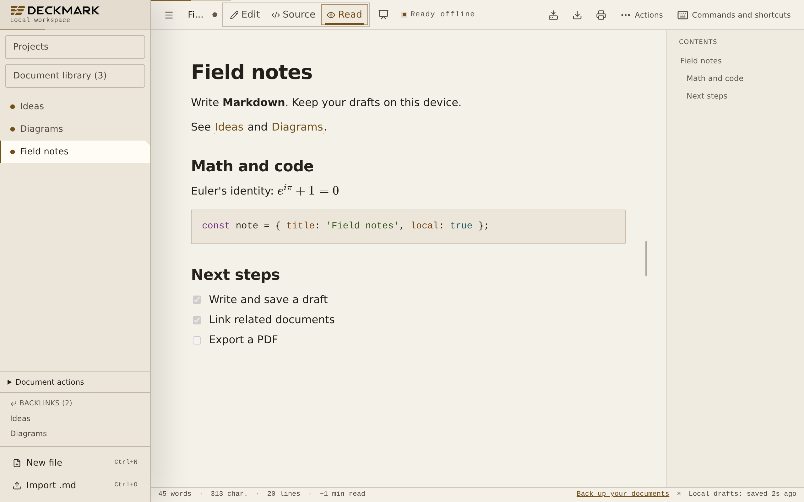

<!-- README standard: filmcraft-inspired/v4; profile: application -->

<p align="center">
  <picture>
    <source media="(prefers-color-scheme: dark)" srcset="static/brand/logo-dark.svg">
    
  </picture>
</p>

<h1 align="center">DeckMark</h1>

<p align="center"><strong>Your Markdown. On your device.</strong></p>

<p align="center">
  <a href="https://thomascrouzet.github.io/deckmark/"><strong>Open the web app</strong></a> ·
  <a href="#get-started">Get started</a> ·
  <a href="#browser-and-desktop-support">Desktop and browsers</a> ·
  <a href="#documentation">Docs</a> ·
  <a href="#status">Status</a>
</p>

<!-- readme:section positioning -->
## Why DeckMark?

DeckMark is a Markdown workspace for notes, linked documents, and presentations.
Write visually, edit the source, read the result, or arrange slides from the same
file. The web app stores drafts on your device and works offline after its
offline resources are ready. An optional Desktop Beta adds native file access.

Use it for a personal document library that you can export as plain files.
Cloud sync, shared editing, and plugins are outside the project scope.

<a id="privacy-and-limits"></a>
<!-- readme:section privacy -->
## Privacy and local storage

**Accounts:** No product account, external-service account, or API key is required.

**Telemetry:** The app sends no telemetry or crash reports. Errors go to the local console and in-app notifications.

**Data:** Drafts, projects, assets, history, workspaces, and templates use IndexedDB on your device. Interface preferences use localStorage. The web app contacts its host to load and update app files; it does not upload documents. Remote images are blocked until you choose to load them. That action contacts the image host and reveals your IP address, without cookies or a referrer.

There is no required backend, cloud storage, or runtime CDN. Rendering sanitizes
document HTML. See the [security policy](SECURITY.md) for data flows and controls.

**Browser storage is not a backup.** Export a copy before you clear browser data
or change profiles. Draft saves use a **400 ms** delay and report write failures.
If the status says **Not saved locally**, keep the editor open, free storage, and
select **Retry save**. A browser or system crash can lose text that has not reached
IndexedDB.

<!-- readme:section capabilities -->
## One document, four views


| View | What you can do |
| --- | --- |
| **Edit** | Write visually. Use `/h1` or `/t1` for headings. Add tables, checklists, images, formulas, and diagrams. |
| **Source** | Edit Markdown with syntax highlighting, search, replacement, and per-document undo. Open a rendered preview beside the source. |
| **Read** | Read the rendered document and use its outline to move between sections. |
| **Slides** | Arrange text, images, shapes, and connectors on a canvas. Add presenter notes and present in full screen. |

The source preview divider works with the pointer or arrow keys. The app remembers
its position and stacks the panes on narrow screens.

Presentations stay in one Markdown file. A terminal metadata block stores slide
layouts, and the body keeps text and images readable in other editors. Print one
slide per page without presenter notes. See the
[presentation guide](docs/presentation-editor.md) and
[file format](docs/presentation-format.md).

DeckMark starts in dark mode with the Relay identity: graphite, warm text, and
amber accents. Choose **Light** for a warm paper canvas or **System** to follow
your device. Settings offers English and French. English is the default; the app
selects French when it detects a French browser language.

<details>
<summary><strong>See visual editing, reading, and the slide editor</strong></summary>

<p align="center">
  <picture>
    <source media="(prefers-color-scheme: dark)" srcset="docs/screenshots/mode-wysiwyg.webp">
    
  </picture>
</p>

<p align="center">
  <picture>
    <source media="(prefers-color-scheme: dark)" srcset="docs/screenshots/mode-read.webp">
    
  </picture>
</p>


</details>

<!-- readme:section capabilities -->
## Keep your documents together

- **Write structured content:** use GFM tables, task lists, code blocks, KaTeX
  formulas, Mermaid diagrams, YAML front matter, and embedded images.
- **Find and connect notes:** use tags, document search, wiki links, backlinks,
  and the link graph. Workspaces and templates help organize recurring work.
- **Review changes:** compare version history, disk conflicts, and cross-file
  replacements before you apply them.
- **Manage the library:** find open and closed documents, select several files,
  and restore deleted documents from trash. Closing a tab keeps its document in
  the library. Deleting a document moves it to trash for 30 days.
- **Keep portable projects:** import a folder or ZIP with document paths and
  local assets. Export the project with its resources and a link report.
- **Save back to disk:** keep file links in supported browsers and Desktop.
  Revision checks detect external edits before an overwrite. Disk saves require
  an explicit action; a local draft save does not write to the linked file.

<!-- readme:section capabilities -->
## Export and back up

Download Markdown, a library or project ZIP, or self-contained HTML for offline
reading. PDF export opens the browser or system print dialog after it prepares
the document content. Select a PDF printer there. The **PDF (A4)** editor width
guides you to a 178 mm text area; the print dialog controls final page settings.

Use **Settings > Export a backup** to keep a JSON copy outside browser storage.
Settings can also check a backup before restore. Backups include open and closed
documents, projects, assets, workspaces, and custom templates. They exclude trash,
version history, and disk permissions.

Optional backup encryption uses AES-GCM and PBKDF2 through WebCrypto. Keep the
passphrase: an encrypted backup cannot be recovered without it. See
[backups and storage health](docs/USER_GUIDE.md#backups-and-storage-health).

<!-- readme:section compatibility -->
## Browser and Desktop support

The web app needs no installation. Disk access depends on the browser:

| Platform | Test scope | Save back to a disk file |
| --- | --- | --- |
| Chromium | Full desktop suite and mobile workflows | File System Access API where available |
| Firefox | Selected core workflows | Download fallback |
| Safari / WebKit | Selected desktop and mobile workflows | Download fallback |
| Desktop Beta | Tauri app with native WebView tests | Native file access on macOS, Windows, and Linux |

[Desktop Beta downloads](https://github.com/ThomasCrouzet/deckmark/releases) are
separate prereleases. Installers are unsigned and can trigger an operating-system
warning. Older releases can use the previous mdsh name. The Desktop release
workflow includes checksums, dependency inventories, and build provenance.
See the [Desktop guide](docs/USER_GUIDE.md#desktop-beta-app) for requirements.

The interface supports keyboard navigation and reduced motion. Browser tests
check focus behavior and accessibility rules. These checks do not replace a human
accessibility audit. The test scope above describes the configured suites, not a
claim that every test passes on every device.

<a id="start-writing"></a>
<!-- readme:section get-started -->
## Get started

### Write and export your first note

**Requirements:** A browser with JavaScript and IndexedDB, and a connection for
the first load. No credentials or configuration are required.

1. Open the [web app](https://thomascrouzet.github.io/deckmark/) and select
   **New file**. You can also import Markdown or open the built-in demo.
2. Select **Source** and enter this Markdown:

   ```markdown
   # Field notes

   - [x] Write a local note
   - [ ] Export a copy
   ```

3. Select **Read**. The document shows the **Field notes** heading and two task
   items, with the first item checked.
4. Wait for **Local drafts: saved** in the status bar. Reload the page to open
   the saved document again.
5. Use **Actions > Export as markdown** to download the source. Use
   **Settings > Export a backup** to keep a copy of the full library.

### Work offline

Use the browser install action to add the PWA. Wait until **Ready offline**
appears before you disconnect. Editing, rendering, search, and export then work
without a connection. Remote images must first be embedded or imported to remain
available offline. See [PWA installation](docs/USER_GUIDE.md#install-the-pwa).

### Useful shortcuts

Use **Control** instead of **Command** on Windows and Linux. **Commands** lists
all shortcuts, and Settings lets you change application shortcuts.

| Default shortcut | Action |
| --- | --- |
| `Cmd+N` / `Cmd+O` | New document / import Markdown |
| `Cmd+E` / `Cmd+/` / `Cmd+R` | Edit / Source / Read |
| `Cmd+Shift+P` | Command palette |
| `Cmd+F` / `Cmd+Shift+F` | Find in document / search across documents |
| `Cmd+S` / `Cmd+Shift+S` | Export Markdown / save to disk |
| `Cmd+P` / `Cmd+,` | Export PDF / Settings |
| `Cmd+Shift+L` | Slides |
| `Ctrl+Tab` / `Ctrl+Shift+Tab` | Next / previous open document |

Some browsers reserve these keys. Use **Commands** when a shortcut is unavailable.

### Build and contribute

Use **Node 22 or later** and npm. The package declares npm 10.9.8. Run these
commands for a new checkout; the committed lockfile fixes dependency versions:

```sh
git clone https://github.com/ThomasCrouzet/deckmark.git
cd deckmark
npm ci --legacy-peer-deps
npm run dev
```

Open the local URL that Vite prints, then follow the first-note steps above.
The development server is for local work. Use a production build to check PWA
installation and offline behavior.

Before a pull request:

```sh
npm run check
npm run lint
npm test
npm run build
npm run size
npx playwright install --with-deps chromium firefox webkit
npx playwright test --ignore-snapshots --grep-invert "Snapshots visuels"
```

On Linux without a display, prefix the final command with `xvfb-run -a`.
Browser tests produce HTML and JSON reports. E2E tests are the preferred method;
isolated tests cover documented failure risks that browser workflows miss.
See the [test policy and artifacts](docs/TESTING.md).

The stack uses **Svelte 5**, **SvelteKit**, **TypeScript**, **Milkdown**,
**CodeMirror**, **Dexie**, and **Tauri 2**. Desktop builds also need the Rust version
and native libraries specified in [CONTRIBUTING.md](CONTRIBUTING.md).

<!-- readme:section documentation -->
## Documentation

| Guide | Contents |
| --- | --- |
| [User guide](docs/USER_GUIDE.md) | Editing, imports, images, disk links, backups, and shortcuts. |
| [Presentation editor](docs/presentation-editor.md) · [File format](docs/presentation-format.md) | Create, present, and export Markdown slide decks. |
| [Contributing](CONTRIBUTING.md) · [Development](docs/DEVELOPMENT.md) | Setup, code rules, and module reference. |
| [Architecture](ARCHITECTURE.md) | Storage, offline resources, rendering, and native file access. |
| [Testing](docs/TESTING.md) | Failure risks, browser commands, and repeatable report artifacts. |
| [Security policy](SECURITY.md) | Privacy boundaries and private vulnerability reports. |
| [Releases](https://github.com/ThomasCrouzet/deckmark/releases) · [Changelog](CHANGELOG.md) | Published versions and changes. |
| [Brand assets and demo capture](docs/BRANDING.md) | Logos, screenshots, and capture commands. |
| [Support](SUPPORT.md) · [Documentation index](docs/README.md) | Help, reporting rules, and the complete guide list. |

<!-- readme:section status -->
## Status

DeckMark provides a static web PWA and an optional **Desktop Beta**. Editing,
linked documents, portable projects, backups, and Markdown presentations are
implemented. See the [changelog](CHANGELOG.md) for release history.

Current limits:

- **Library size:** the working target is about **200 to 300 documents**.
- **Imports:** a file selection accepts up to 300 files and 64 MiB in total,
  with a 16 MiB limit per document. Projects have additional asset and archive
  limits. See [import limits](docs/USER_GUIDE.md#import-documents) and
  [portable projects](docs/USER_GUIDE.md#portable-projects).
- **Source formatting:** sentence edits in the visual editor retain formatting
  outside the changed content. Structural edits can require new Markdown syntax.
  Use Source for syntax that the visual editor cannot represent. The
  [source fidelity harness](docs/testing/source-fidelity.md) checks exported
  source and records changes outside the expected edit.
- **Presentations:** a deck uses the same document limits as an ordinary draft.
  Its default canvas is 1280 by 720 pixels, with support for 16:9 and 4:3 decks.
- **Disk conflicts:** revision checks cannot prevent another application from
  writing after the final check. Avoid simultaneous writes to a linked file.

Report bugs through [Issues](https://github.com/ThomasCrouzet/deckmark/issues).
Include the app version, browser or operating system, steps, and expected result.
Report security findings privately through [SECURITY.md](SECURITY.md).

<!-- readme:section license -->
## License

[MIT](LICENSE). Copyright (c) 2026 Thomas Crouzet.
See [THIRD_PARTY_NOTICES.md](THIRD_PARTY_NOTICES.md) for redistributed asset notices.
