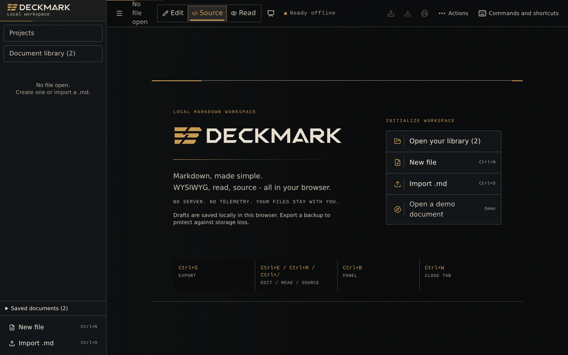
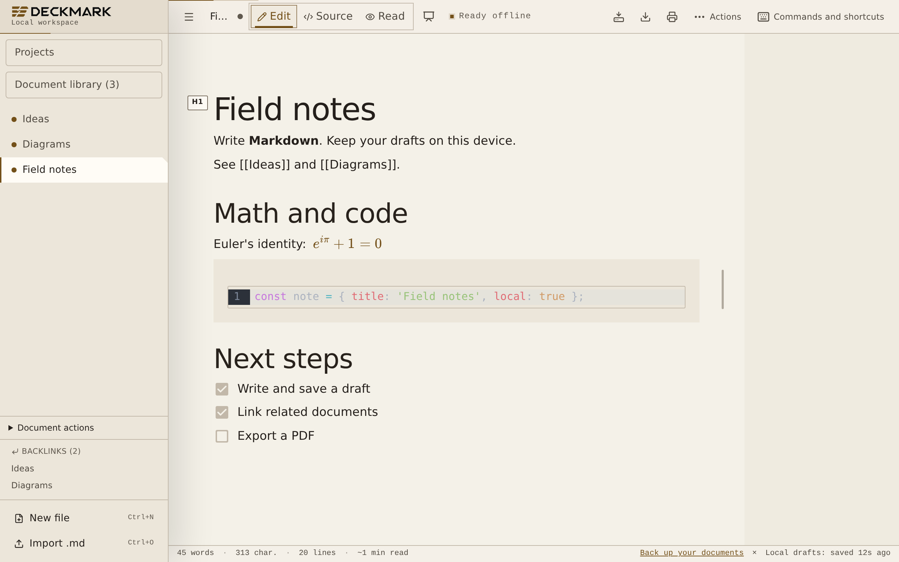
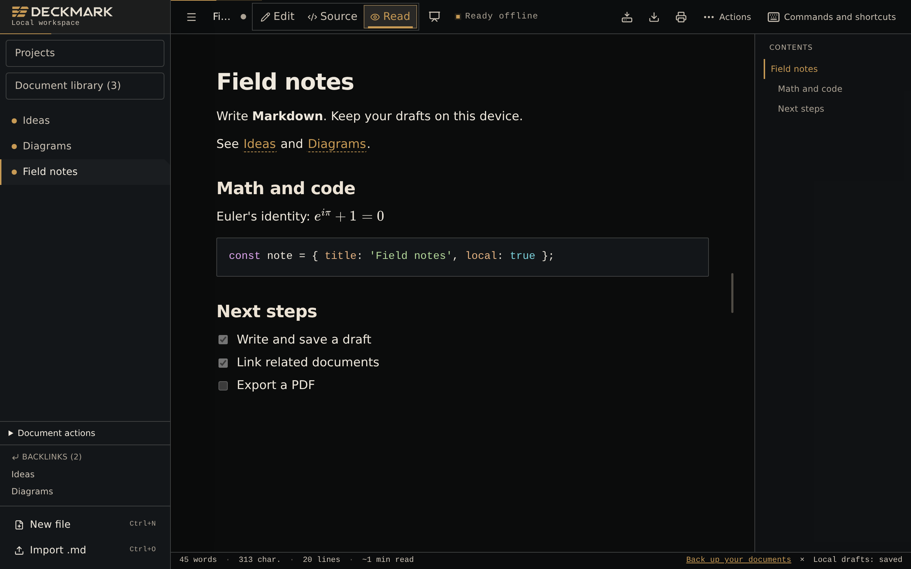
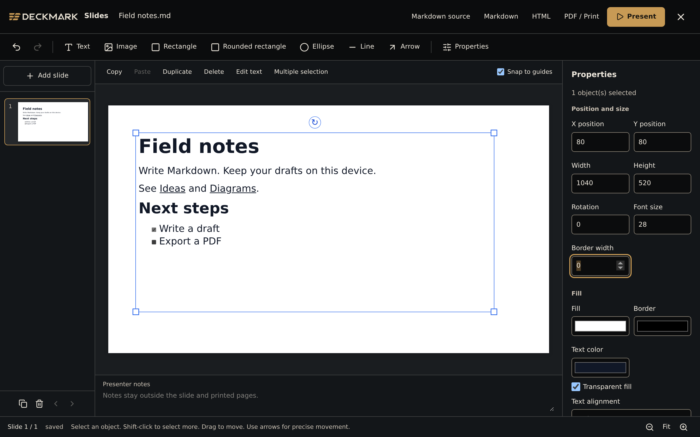

<p align="center">
  <picture>
    <source media="(prefers-color-scheme: dark)" srcset="static/brand/logo-dark.svg">
    <source media="(prefers-color-scheme: light)" srcset="static/brand/logo-light.svg">
    
  </picture>
</p>

<h1 align="center">DeckMark</h1>

<p align="center">
  <strong>Your Markdown. On your device.</strong><br>
  Write, connect, and present documents in a local workspace.<br>
  No account. No cloud sync. No telemetry.
</p>

<p align="center">
  <a href="https://thomascrouzet.github.io/deckmark/"><strong>Open the web app</strong></a> ·
  <a href="https://github.com/ThomasCrouzet/deckmark/releases">Download Desktop Beta</a> ·
  <a href="docs/USER_GUIDE.md">User guide</a>
</p>

<p align="center">
  <a href="https://github.com/ThomasCrouzet/deckmark/actions/workflows/deploy.yml"></a>
  <a href="https://github.com/ThomasCrouzet/deckmark/actions/workflows/security.yml"></a>
  <a href="LICENSE"></a>
</p>



[View a still image](docs/screenshots/mode-wysiwyg.webp) · [More screenshots](#one-document-four-views)

## Start writing

1. Open the [web app](https://thomascrouzet.github.io/deckmark/). Create a file,
   import Markdown, or open the built-in demo.
2. Write in **Edit**, change to **Source**, or select **Read**. Your draft stays
   in the current browser profile.
3. Export your work. Use **Settings > Export a backup** to keep a copy outside
   the browser.

To work offline, use the browser install action to add the PWA. Wait until
**Ready offline** appears before you disconnect. Editing, rendering, search,
and export then work without a connection.
See [PWA installation](docs/USER_GUIDE.md#install-the-pwa).

## One document, four views

| View | What you can do |
| --- | --- |
| **Edit** | Write visually. Use `/h1` or `/t1` for headings. Add tables, checklists, images, formulas, and diagrams. |
| **Source** | Edit Markdown with syntax highlighting, search, replacement, and per-document undo. Open a rendered preview beside the source. |
| **Read** | Read the rendered document and use its outline to move between sections. |
| **Slides** | Arrange text, images, shapes, and connectors on a canvas. Add presenter notes and present in full screen. |

The source preview divider works with the pointer or arrow keys. The app remembers
its position and stacks the panes on narrow screens.

Presentations stay in one Markdown file. A terminal metadata block stores slide
layouts, and the body keeps text and images readable in other editors. Print one
slide per page without presenter notes. See the
[presentation guide](docs/presentation-editor.md) and
[file format](docs/presentation-format.md).

DeckMark starts in dark mode with the Relay identity: graphite, warm text, and
amber accents. Choose **Light** for a warm paper canvas or **System** to follow
your device. Settings also offers an English or French interface.

<details>
<summary><strong>See the light theme, reading view, and slide editor</strong></summary>







</details>

## Keep your documents together

- **Write structured content:** use GFM tables, task lists, code blocks, KaTeX
  formulas, Mermaid diagrams, YAML front matter, and embedded images.
- **Find and connect notes:** use tags, document search, wiki links, backlinks,
  and the link graph. Workspaces and templates help organize recurring work.
- **Review changes:** compare version history, disk conflicts, and cross-file
  replacements before you apply them.
- **Manage the library:** find open and closed documents, select several files,
  and restore deleted documents from trash.
- **Keep portable projects:** import a folder or ZIP with document paths and
  local assets. Export the project with its resources and a link report.
- **Save back to disk:** keep file links in supported browsers and Desktop.
  Revision checks detect external edits before an overwrite.

## Export and back up

Download Markdown, a library or project ZIP, content-only PDF, or self-contained
HTML for offline reading. The **PDF (A4)** editor width guides you to a 178 mm
text area. The print dialog controls the final page settings.

Use **Settings** to export or check a JSON backup, with optional encryption.
Backups include open and closed documents, projects, assets, workspaces, and
custom templates. They exclude trash, version history, and disk permissions.
Encryption uses AES-GCM and PBKDF2 through WebCrypto.
See [backups and storage health](docs/USER_GUIDE.md#backups-and-storage-health).

**Browser storage is not a backup.** Export a copy before you clear browser data
or change profiles. Drafts use IndexedDB, save after a **400 ms** delay, and report
write failures. Closing a document tab keeps it in the library. Deleting a
document moves it to trash for 30 days.

## Browser and Desktop support

The web app needs no installation. Disk access depends on the browser:

| Platform | Test scope | Save back to a disk file |
| --- | --- | --- |
| Chromium | Full desktop suite and mobile workflows | File System Access API where available |
| Firefox | Core workflow tests | Download fallback |
| Safari / WebKit | Core desktop and mobile workflow tests | Download fallback |
| Desktop Beta | Tauri app with native WebView tests | Native file access on macOS, Windows, and Linux |

[Desktop Beta downloads](https://github.com/ThomasCrouzet/deckmark/releases) are
separate prereleases. Installers are unsigned and can trigger an operating-system
warning. Older releases can use the previous mdsh name. Each release includes
checksums and build provenance. See the
[Desktop guide](docs/USER_GUIDE.md#desktop-beta-app) for requirements.

The interface supports keyboard navigation and reduced motion. Browser tests
check focus behavior and accessibility rules. These checks do not replace a human
accessibility audit.

## Privacy and limits

The app has no required backend, account, telemetry, cloud sync, or runtime CDN.
Documents stay on your device. Document HTML is sanitized, and remote images stay
blocked until you choose to load them for that document. Loading a remote image
contacts its host. See [SECURITY.md](SECURITY.md).

The working target is about **200 to 300 documents**. A file import accepts up to
300 files and 64 MiB in total, with a 16 MiB limit per document. Projects have
additional asset and archive limits. See the
[import limits](docs/USER_GUIDE.md#import-documents) and
[portable project guide](docs/USER_GUIDE.md#portable-projects).

Visual editing can normalize Markdown. Use Source when exact formatting matters.
A presentation uses the same document limits as an ordinary draft. Its default
canvas is 1280 by 720 pixels, with support for 16:9 and 4:3 decks. Cloud services,
collaboration, and plugins are outside the project scope.

## Useful shortcuts

Use **Control** instead of **Command** on Windows and Linux. **Commands** lists
all shortcuts, and Settings lets you change them.

| Default shortcut | Action |
| --- | --- |
| `Cmd+N` / `Cmd+O` | New document / import Markdown |
| `Cmd+E` / `Cmd+/` / `Cmd+R` | Edit / Source / Read |
| `Cmd+Shift+P` | Command palette |
| `Cmd+F` / `Cmd+Shift+F` | Find in document / search across documents |
| `Cmd+S` / `Cmd+Shift+S` | Export Markdown / save to disk |
| `Cmd+P` / `Cmd+,` | Export PDF / Settings |
| `Cmd+Shift+L` | Slides |
| `Ctrl+Tab` / `Ctrl+Shift+Tab` | Next / previous open document |

Some browsers reserve these keys. Use **Commands** when a shortcut is unavailable.

## Build and contribute

Use **Node 22 or later** and npm. The committed lockfile fixes dependency versions.

```sh
npm ci --legacy-peer-deps
npm run dev
```

Before a pull request:

```sh
npm run check
npm run lint
npm test
npm run build
npm run size
npx playwright install --with-deps chromium firefox webkit
npx playwright test --ignore-snapshots --grep-invert "Snapshots visuels"
```

On Linux without a display, prefix the final command with `xvfb-run -a`.
Browser tests produce HTML and JSON reports. E2E tests are the preferred method;
isolated tests cover documented failure risks that browser workflows miss.
See the [test policy and artifacts](docs/TESTING.md).

The stack uses **Svelte 5**, **SvelteKit**, **TypeScript**, **Milkdown**,
**CodeMirror**, **Dexie**, and **Tauri 2**. Desktop builds also need the Rust version
and native libraries specified in [CONTRIBUTING.md](CONTRIBUTING.md).

[Contributing](CONTRIBUTING.md) · [Architecture](ARCHITECTURE.md) ·
[Development](docs/DEVELOPMENT.md) · [Documentation index](docs/README.md) ·
[Brand assets and demo capture](docs/BRANDING.md) ·
[Issues](https://github.com/ThomasCrouzet/deckmark/issues) · [Support](SUPPORT.md)

## License

[MIT](LICENSE). See [THIRD_PARTY_NOTICES.md](THIRD_PARTY_NOTICES.md) for redistributed
asset notices.
