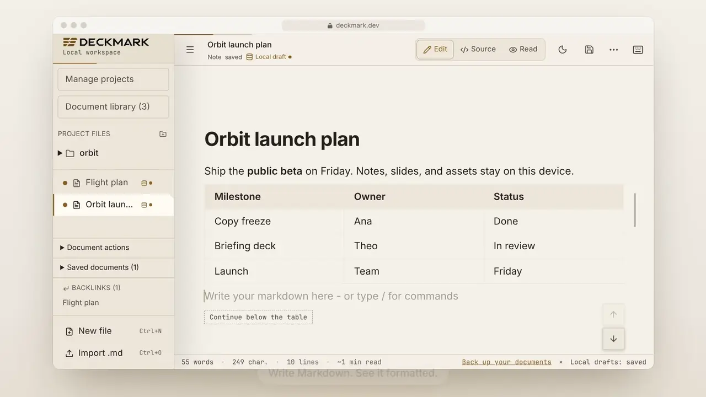
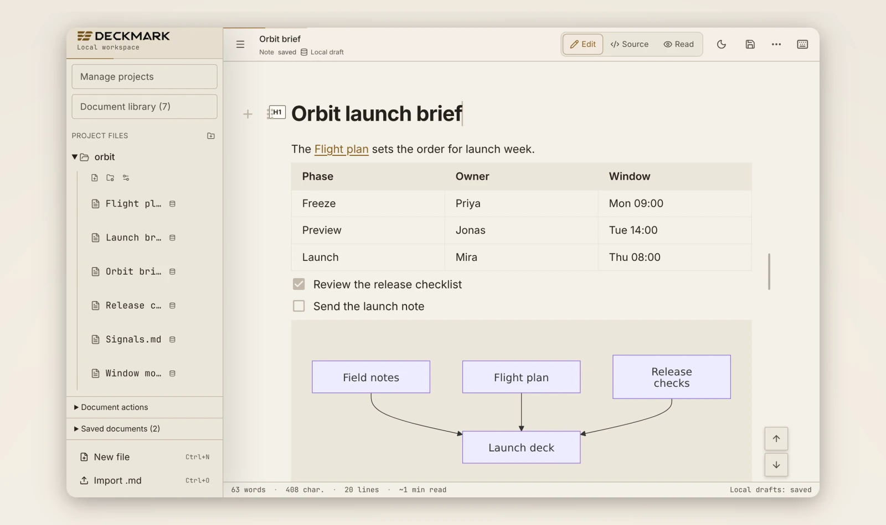
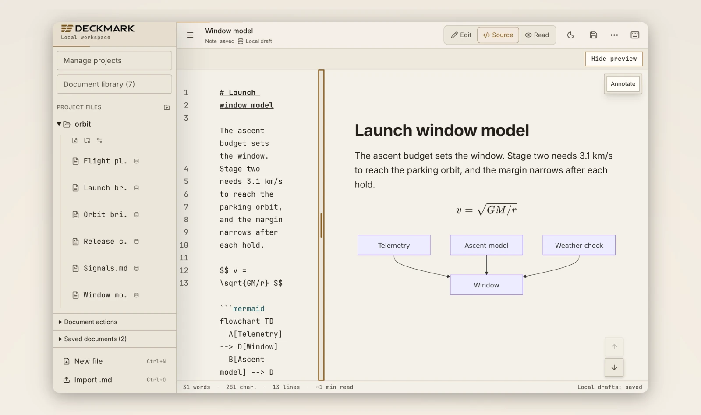
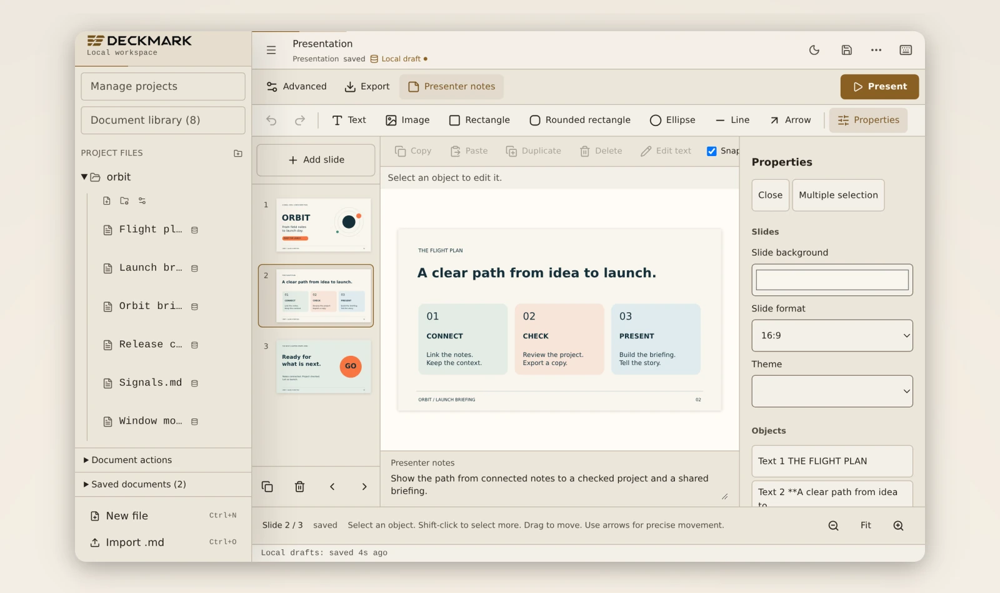
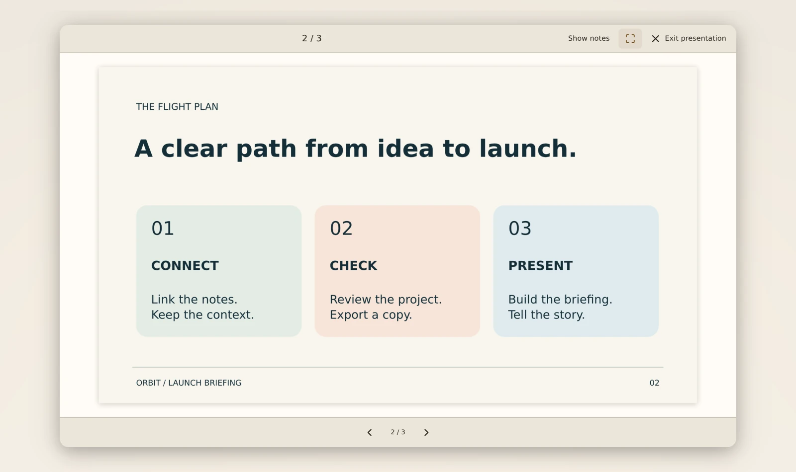

<p align="center">
  <picture>
    <source media="(prefers-color-scheme: dark)" srcset="static/brand/logo-dark.svg">
    
  </picture>
</p>

<h3 align="center">Your Markdown. On your device.</h3>

<p align="center">
  Write notes, draw diagrams, and present slides from plain Markdown files.<br>
  It opens in a browser tab, works offline, and never asks for an account.
</p>

<p align="center">
  <a href="https://www.deckmark.dev/"><strong>Open the web app</strong></a> ·
  <a href="https://github.com/ThomasCrouzet/deckmark/releases">Download for desktop</a> ·
  <a href="docs/USER_GUIDE.md">User guide</a>
</p>

<p align="center">
  <a href="https://github.com/ThomasCrouzet/deckmark/releases"></a>
  <a href="LICENSE"></a>
  
  
</p>

<p align="center">
  <a href="https://www.deckmark.dev/">
    <picture>
      <source media="(prefers-color-scheme: dark)" srcset="docs/hero-dark.webp">
      
    </picture>
  </a>
</p>

<!-- readme:section positioning -->
## Why DeckMark

- **Notes and slides, one format.** A note and a deck are both Markdown files in the
  same library. Link them, search them, export them, open them in any other editor.
- **Nothing leaves your device.** No server, no account, no telemetry. Drafts stay in
  your browser storage, and every export is a plain file you own.
- **Starts in a tab, grows with you.** Use it at [deckmark.dev](https://www.deckmark.dev/)
  with no install, keep it offline as a PWA, or take the desktop app for native files.

| | DeckMark | Obsidian | Typora | Joplin |
| --- | :---: | :---: | :---: | :---: |
| License, price | MIT, free | Proprietary, free (paid Sync and Publish add-ons) | Proprietary, paid after a 15-day trial | AGPL-3.0, free |
| Use without an account or server | ✅ | ✅ | ✅ | Sync optional |
| Runs in a browser tab, install-free | ✅ | App install | App install | App install |
| Markdown presentations | Built-in slide editor and present mode | Core Slides plugin (basic) | Reveal.js export through Pandoc | Community plugins |
| Mobile apps | Installable PWA, no native app | iOS and Android | No | iOS and Android |
| Plugins and sync services | None | Community plugins, paid Sync | Themes only | Plugins, several sync services |

<sub>Checked 27 November 2026 against each project's license file, pricing page, and documentation. Verify each product's current terms.</sub>

<!-- readme:section get-started -->
## Get started

**In your browser, in 30 seconds.** Open [deckmark.dev](https://www.deckmark.dev/)
([GitHub Pages mirror](https://thomascrouzet.github.io/deckmark/)), select
**New file &rarr; Note**, and start typing. The status bar shows
**Local drafts: saved**; reload the page and your note is still there.

**Offline.** Install the PWA and wait for **Ready offline**. Editing, rendering,
search, and export then work without a connection.
See [PWA installation](docs/USER_GUIDE.md#install-the-pwa).

**On the desktop.** [Desktop Complete (Beta)](https://github.com/ThomasCrouzet/deckmark/releases)
adds native file access, in-place saves, an optional local Git panel, and OS integration
on macOS, Windows, and Linux. See [Install the desktop app](#install-the-desktop-app).

<!-- readme:section capabilities -->
<a id="notes-and-presentations"></a>
## What you can do

<table>
<tr>
  <td width="50%" valign="top">
    <strong>Write</strong><br>
    <picture>
      <source media="(prefers-color-scheme: dark)" srcset="docs/screenshots/readme-write-dark.webp">
      
    </picture>
    <sub>Edit, Source, and Read modes. Tables, task lists, KaTeX, Mermaid, front matter, tags, and wiki links with backlinks.</sub>
  </td>
  <td width="50%" valign="top">
    <strong>See the source and the result</strong><br>
    <picture>
      <source media="(prefers-color-scheme: dark)" srcset="docs/screenshots/readme-split-dark.webp">
      
    </picture>
    <sub>Split view renders formulas and diagrams as you type.</sub>
  </td>
</tr>
<tr>
  <td width="50%" valign="top">
    <strong>Build slides</strong><br>
    <picture>
      <source media="(prefers-color-scheme: dark)" srcset="docs/screenshots/readme-present-dark.webp">
      
    </picture>
    <sub>Text, shapes, images, connectors, and presenter notes. The deck stays a readable Markdown file.</sub>
  </td>
  <td width="50%" valign="top">
    <strong>Present</strong><br>
    <picture>
      <source media="(prefers-color-scheme: dark)" srcset="docs/screenshots/readme-present-mode-dark.webp">
      
    </picture>
    <sub>Full screen with keyboard or touch. Export to Markdown, HTML, or PDF.</sub>
  </td>
</tr>
</table>

**Keep a library, not a pile of files.** Wiki links, backlinks, a link graph, and
search across documents. Snippets, templates, linked content blocks, and version
history. Import a folder or ZIP, check its links offline, and export a project ZIP or a
static docs site.

**More than notes.** Open code and JSON files with syntax highlighting, formatting,
and validation. Import images and annotate them, or view imported PDFs.

**Every command, one search away.** Press <kbd>Ctrl</kbd>+<kbd>Shift</kbd>+<kbd>P</kbd>
(<kbd>Cmd</kbd>+<kbd>Shift</kbd>+<kbd>P</kbd> on macOS).

**Scriptable.** A Node [CLI](docs/CLI.md) validates links, anchors, and front matter
and exports projects from scripts and CI. A local [MCP server](docs/MCP.md) exposes
read, search, check, and patch-proposal tools. Both run from a source checkout.

<!-- readme:section privacy -->
<a id="privacy-and-limits"></a>
## Private by design

- **No account, no telemetry, no crash reports.** No document data leaves your device
  unless you load a remote image or send context to a provider you configure.
- **Your drafts stay local** in IndexedDB. Remote images stay blocked until you allow them.
- **AI is optional and off by default.** An OpenAI-compatible connection sends only the
  context you review. See [AI and network access](docs/USER_GUIDE.md#ai-and-network-access).
- **Back up what matters.** Browser storage is not a backup. **Settings &rarr; Export a
  backup** writes a JSON copy, optionally encrypted with AES-GCM. Exports are plain
  Markdown, self-contained HTML, PDF, and ZIP.

Data flows and controls: [SECURITY.md](SECURITY.md).

<!-- readme:section compatibility -->
## Editions and support

| Edition | Tested on | Save back to a disk file |
| --- | --- | --- |
| **Web Light**, Chromium | Full desktop suite and mobile workflows | File System Access API |
| **Web Light**, Firefox and Safari | Selected workflows | Download fallback |
| **Desktop Complete (Beta)**, macOS, Windows, Linux | Tauri app with native WebView tests | Native in-place saves |

Web Light is stable and free, not a trial. Both editions share one portable format.
Out of scope today: cloud sync, shared editing, accounts, and plugins. The working target
is about 200 to 300 documents. Details: [edition matrix](docs/EDITIONS.md).

<a id="install-the-desktop-app"></a>
<details>
<summary><strong>Install the desktop app</strong></summary>

Each release ships four installers, each with `SHA256SUMS` and build provenance:

| Platform | File |
| --- | --- |
| macOS, Apple Silicon | `DeckMark_<version>_macOS_Apple-Silicon.dmg` |
| Windows, x64 | `DeckMark_<version>_x64-setup.exe` (NSIS) |
| Linux, Debian and Ubuntu | `DeckMark_<version>_amd64.deb` |
| Linux, portable | `DeckMark_<version>_amd64.AppImage` |

The installers are not signed yet, so Gatekeeper and SmartScreen can warn on first
launch. Compare each download against `SHA256SUMS` first.

- **macOS:** choose **Open Anyway** in **System Settings > Privacy & Security**, or run
  `xattr -dr com.apple.quarantine /Applications/DeckMark.app`.
- **Windows:** choose **More info > Run anyway**.
- **Linux:** install the `.deb` with your package manager, or mark the `.AppImage`
  executable.

The app does not update itself; install each release manually. See the
[Desktop guide](docs/USER_GUIDE.md#desktop-complete-app).

</details>

<!-- readme:section documentation -->
## Documentation

- [User guide](docs/USER_GUIDE.md) · [Editions](docs/EDITIONS.md) ·
  [Presentation editor](docs/presentation-editor.md) · [File format](docs/presentation-format.md)
- [CLI](docs/CLI.md) · [Local MCP server](docs/MCP.md)
- [Architecture](ARCHITECTURE.md) · [Development map](docs/DEVELOPMENT.md) ·
  [Testing](docs/TESTING.md) · [Contributing](CONTRIBUTING.md)
- [Security policy](SECURITY.md) · [Support](SUPPORT.md) · [Changelog](CHANGELOG.md) ·
  [Documentation index](docs/README.md)

Visual edits keep formatting outside the change; some structural edits need the
**Source** view. The [source fidelity harness](docs/testing/source-fidelity.md) tracks
exported Markdown.

Questions and ideas: [Discussions](https://github.com/ThomasCrouzet/deckmark/discussions).
Bugs: [Issues](https://github.com/ThomasCrouzet/deckmark/issues).

## Develop

Node 22 or later, npm:

```sh
git clone https://github.com/ThomasCrouzet/deckmark.git
cd deckmark
npm ci --legacy-peer-deps
npm run dev
```

<details>
<summary><strong>Checks before a pull request</strong></summary>

```sh
npm run check && npm run lint && npm test && npm run build && npm run size
npx playwright install --with-deps chromium firefox webkit
npx playwright test --ignore-snapshots --grep-invert "Snapshots visuels"
```

On Linux without a display, prefix the final command with `xvfb-run -a`.

</details>

Built with **Svelte 5, SvelteKit, TypeScript, Milkdown, CodeMirror, Dexie, and Tauri 2.**
Code rules and module reference: [CONTRIBUTING.md](CONTRIBUTING.md) and
[docs/DEVELOPMENT.md](docs/DEVELOPMENT.md).

<!-- readme:section license -->
## License

[MIT](LICENSE). Copyright (c) 2026 Thomas Crouzet.
See [THIRD_PARTY_NOTICES.md](THIRD_PARTY_NOTICES.md) for redistributed asset notices.
