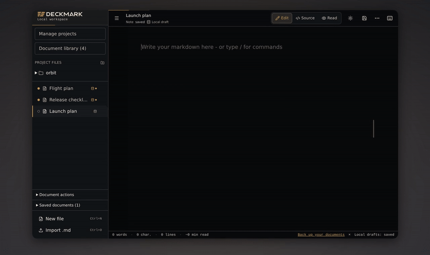

<p align="center">
  <picture>
    <source media="(prefers-color-scheme: dark)" srcset="static/brand/logo-dark.svg">
    
  </picture>
</p>

<h1 align="center">DeckMark</h1>

<p align="center"><strong>Your Markdown. On your device.</strong></p>

<p align="center">
  Notes, presentations, code, images, and imported PDFs in one local-first workspace.<br>
  <strong>No server. No account. No telemetry.</strong>
</p>

<p align="center">
  <a href="https://www.deckmark.dev/"><strong>Open the web app</strong></a> ·
  <a href="#why-deckmark">Why DeckMark</a> ·
  <a href="#get-started">Get started</a> ·
  <a href="docs/EDITIONS.md">Editions</a> ·
  <a href="#documentation">Docs</a> ·
  <a href="https://github.com/ThomasCrouzet/deckmark/releases">Downloads</a>
</p>

<p align="center">
  <a href="https://github.com/ThomasCrouzet/deckmark/releases"></a>
  <a href="LICENSE"></a>
  
  
</p>

<!-- readme:section positioning -->
## Why DeckMark?

Most Markdown tools ask you to trade something: a closed app, a cloud backend, a paid
license, or a proprietary format. DeckMark trades none of those.

- **On your device.** 100% client-side PWA. Drafts live in your browser storage, exports
  are plain Markdown files, and there is no backend or cloud service.
- **A real workspace.** WYSIWYG editing, Markdown source mode, linked notes with
  backlinks and a graph, Markdown presentations, code files, images, and PDF import,
  plus a command palette, templates, snippets, and version history.
- **No lock-in.** Web Light and Desktop Complete share one portable format. Leave any
  time: export your work as Markdown, a project ZIP, or a JSON backup.

| | DeckMark | Obsidian | Typora | Joplin |
| --- | :---: | :---: | :---: | :---: |
| License, price | MIT, free | Proprietary, free for personal use | Proprietary, paid | MIT, free |
| Use without an account or server | ✅ | ✅ | ✅ | Sync optional |
| Runs in a browser tab, install-free | ✅ | App install | App install | App install |
| Built-in Markdown presentations | ✅ | Plugins | ❌ | ❌ |

*Checked November 2026. Verify each product's current terms.*



<!-- readme:section get-started -->
## Get started

**Try it in 30 seconds.** No install, no account:

1. Open the [web app](https://www.deckmark.dev/)
   ([GitHub Pages fallback](https://thomascrouzet.github.io/deckmark/)).
2. Select **New file &rarr; Note**, then paste Markdown in **Source**.
3. Switch to **Read** and wait for **Local drafts: saved** in the status bar.
   Reload the page: your note is still there.
4. Use **Actions &rarr; Download** to export the Markdown source, or
   **Settings &rarr; Export a backup** for the full library.

**Work offline:** install the PWA and wait for **Ready offline**. Editing, rendering,
search, and export then run without a connection. See
[PWA installation](docs/USER_GUIDE.md#install-the-pwa).

**Go desktop:** [Desktop Complete (Beta)](https://github.com/ThomasCrouzet/deckmark/releases)
adds native file access, in-place saves, an optional local Git panel, and OS integration
on macOS, Windows, and Linux. Beta installers are unsigned: compare downloads against
`SHA256SUMS` in the release.

<!-- readme:section capabilities -->
<a id="notes-and-presentations"></a>
## One library, many document types

| Document type | What you can do |
| --- | --- |
| **Note** | **Edit**, **Source**, and **Read** modes. Tables, checklists, images, KaTeX formulas, Mermaid diagrams, YAML front matter, an outline, tags, and wiki links. |
| **Presentation** | Arrange slides with text, shapes, images, and connectors. Presenter notes, full-screen presenting, and export to Markdown, HTML, or PDF. A deck stays a readable Markdown file. |
| **Code / JSON** | Create or import text and code files. Syntax highlighting, search, indentation, JSON checks, formatting, and minification. |
| **Image / PDF** | Import images and PDFs. Annotate images and export a flattened PNG. PDF viewing depends on the browser viewer and policy. |

<!-- readme:section capabilities -->
## Keep your documents together

- **Link and find:** wiki links, backlinks, a link graph, cross-document search, and an
  optional local search index built without any provider request or model download.
- **Reuse content:** snippets with tags and placeholders, custom templates, and linked
  content blocks with a readable Markdown snapshot.
- **Review changes:** version history, conflict detection for disk-linked files, and
  cross-file replacements you confirm before applying.
- **Portable projects:** import a folder or ZIP and export a project ZIP with document
  paths and local assets. Run documentation checks offline and export a static docs site.
- **Save back to disk:** in supported browsers and on Desktop, with revision checks
  before an overwrite. Saves are always explicit.

**Export and back up:** Markdown, self-contained HTML, PDF through the print dialog,
library and project ZIP files. **Settings &rarr; Export a backup** writes a JSON copy
outside browser storage, optionally encrypted with AES-GCM.

**Scripting:** a Node CLI runs the documentation checker and project export from scripts
and CI, and a local MCP server exposes read, search, check, and patch-proposal tools.
Both run from a source checkout. See the [CLI](docs/CLI.md) and [MCP](docs/MCP.md) guides.

<!-- readme:section privacy -->
<a id="privacy-and-limits"></a>
## Privacy in five lines

- **No account, no telemetry, no crash reports.** No document data leaves your device
  unless you load a remote image or send context to a provider you configure.
- **Drafts stay on your device** in IndexedDB, and preferences use localStorage. Remote
  images are blocked until you choose to load them.
- **AI is optional and off by default.** An OpenAI-compatible connection only sends
  the context you review. See [AI and network access](docs/USER_GUIDE.md#ai-and-network-access).
- **Browser storage is not a backup.** If the status shows **Not saved locally**, keep
  the editor open, free storage, and select **Retry saving**.
- Data flows and controls: [SECURITY.md](SECURITY.md).

<!-- readme:section compatibility -->
## Browser and desktop support

| Edition | Test scope | Save back to a disk file |
| --- | --- | --- |
| **Web Light**, Chromium | Full desktop suite and mobile workflows | File System Access API |
| **Web Light**, Firefox and Safari | Selected workflows | Download fallback |
| **Desktop Complete (Beta)**, macOS, Windows, Linux | Tauri app with native WebView tests | Native in-place saves |

Desktop releases ship four installers: for macOS the Apple Silicon DMG
(`DeckMark_<version>_macOS_Apple-Silicon.dmg`), for Windows the NSIS setup
(`DeckMark_<version>_x64-setup.exe`), and for Linux the deb package and portable
AppImage (`DeckMark_<version>_amd64.deb`, `DeckMark_<version>_amd64.AppImage`),
each with `SHA256SUMS` and build provenance. Installers are unsigned: Gatekeeper
and SmartScreen can warn on first launch. Bundle files use the
`DeckMark_<version>_<platform>` name. If macOS blocks the app, choose **Open Anyway**
in **System Settings > Privacy & Security**, or run
`xattr -dr com.apple.quarantine /Applications/DeckMark.app`. On Windows, choose
**More info > Run anyway**. On Linux, install the `.deb` with your package manager, or
mark the `.AppImage` executable. The app does not auto-update; install each release
manually.
See the [Desktop guide](docs/USER_GUIDE.md#desktop-complete-app).

<!-- readme:section documentation -->
## Documentation

- [Editions and support](docs/EDITIONS.md) · [User guide](docs/USER_GUIDE.md) ·
  [Presentation editor](docs/presentation-editor.md) · [File format](docs/presentation-format.md)
- [CLI](docs/CLI.md) · [Local MCP server](docs/MCP.md)
- [Architecture](ARCHITECTURE.md) · [Development map](docs/DEVELOPMENT.md) ·
  [Testing](docs/TESTING.md) · [Contributing](CONTRIBUTING.md)
- [Security policy](SECURITY.md) · [Support](SUPPORT.md) · [Changelog](CHANGELOG.md) ·
  [Documentation index](docs/README.md)

<!-- readme:section status -->
## Status and limits

DeckMark ships **Web Light** (stable, free, not a trial) and **Desktop Complete (Beta)**.
Out of scope today: cloud sync, shared editing, accounts, plugins, and unrestricted
filesystem access. In short:

- Working target: about **200 to 300 documents**; a direct import accepts up to 300
  files and 64 MiB, with 16 MiB per document.
- Visual edits keep formatting outside the change; some structural edits need the
  **Source** view. The [source fidelity harness](docs/testing/source-fidelity.md)
  tracks exported Markdown.
- A deck uses the same limits as a note: a 1280 by 720 canvas, with 16:9 and 4:3 support.

Full details: [edition matrix](docs/EDITIONS.md). Questions and ideas:
[Discussions](https://github.com/ThomasCrouzet/deckmark/discussions). Bugs:
[Issues](https://github.com/ThomasCrouzet/deckmark/issues).

## Develop

Node 22 or later, npm:

```sh
git clone https://github.com/ThomasCrouzet/deckmark.git
cd deckmark
npm ci --legacy-peer-deps
npm run dev
```

<details>
<summary><strong>Checks before a pull request</strong></summary>

```sh
npm run check && npm run lint && npm test && npm run build && npm run size
npx playwright install --with-deps chromium firefox webkit
npx playwright test --ignore-snapshots --grep-invert "Snapshots visuels"
```

On Linux without a display, prefix the final command with `xvfb-run -a`.

</details>

Stack: **Svelte 5, SvelteKit, TypeScript, Milkdown, CodeMirror, Dexie, Tauri 2.**
Code rules and module reference: [CONTRIBUTING.md](CONTRIBUTING.md) and
[docs/DEVELOPMENT.md](docs/DEVELOPMENT.md).

<!-- readme:section license -->
## License

[MIT](LICENSE). Copyright (c) 2026 Thomas Crouzet.
See [THIRD_PARTY_NOTICES.md](THIRD_PARTY_NOTICES.md) for redistributed asset notices.
