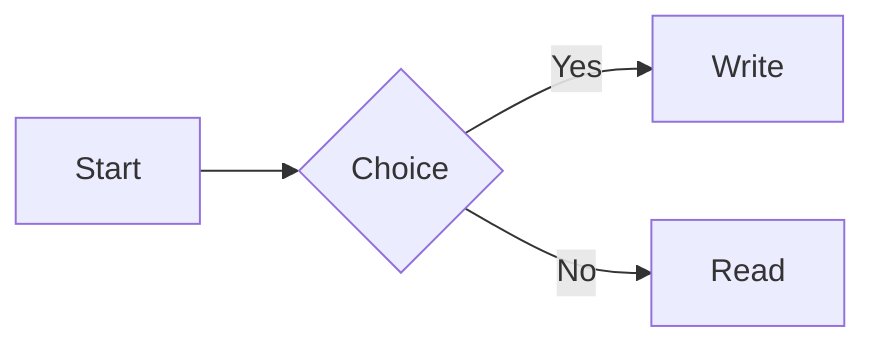

# Benchmark small note

This note is a local benchmark fixture. It has no personal data and no network reference.

- First item with a [[Benchmark backlog]] link.
- Second item with `inline code`.
- Third item with a [relative link](./benchmark-small.md).

| Column A | Column B | Column C |
| --- | --- | --- |
| Alpha | Beta | Gamma |
| Delta | Epsilon | Zeta |

```js
const total = [1, 2, 3].reduce((sum, value) => sum + value, 0);
console.log(total);
```

Inline math $e^{i\pi}+1=0$ and a block:

$$
\int_0^1 x^2\,dx = \frac{1}{3}
$$


